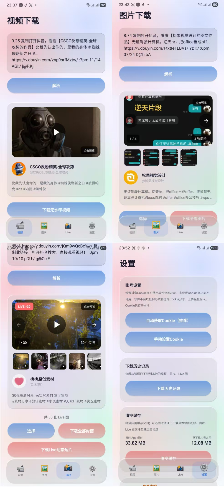
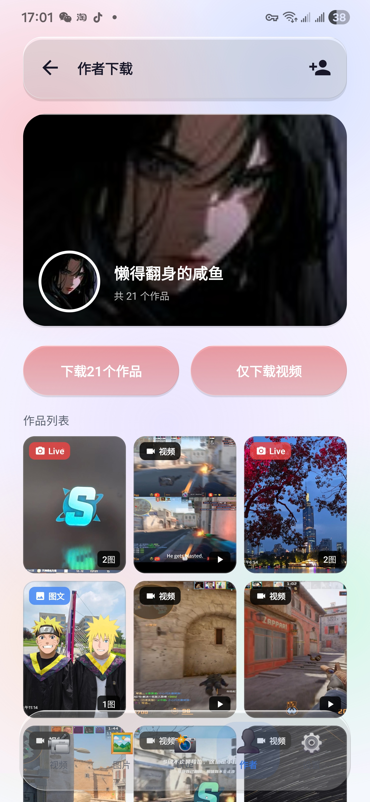

# 抖净-DouyinDownload（抖音 / 快手 无水印下载、Live 实况照片合成 Android App）

抖音、快手作品下载，以及抖音 Live 实况图合成，Android 原生应用（Java 协议层 + Jetpack Compose UI）

本项目参考了 [halcyra/DYDownloader](https://github.com/halcyra/DYDownloader) 的解析算法而来，借助大佬的力量进行开发

**⚠️ 仅供个人技术学习使用，禁止商用、禁止违法行为 ⚠️**

## 🎯 项目说明

纯 API / 页面数据方案解析，无需登录即可下载快手作品，抖音作品需填入登录态 Cookie。

**没有 WebView、没有 JS 注入、没有网络拦截**——抖音解析在 `douyin/DouyinDownloader.java`，快手解析在 `kuaishou/KuaishouDownloader.java`，UI 全部在 Compose 层。

当前版本 **v1.6**。

## 📥 下载

- Gitee Releases：<https://gitee.com/jbl2003/DouyinVedioDownload/releases>
- 应用内「设置 → 检查更新」可自动检测新版本（启动时也会检查一次）

## 📱软件截图





## ✨ 主要功能

| 功能 | 支持平台 | 说明 |
|------|---------|------|
| 视频下载 | 抖音 / 快手 | 解析分享链接，下载无水印最高档视频，不二次转码 |
| 图片作品下载 | 抖音 / 快手 | 抖音原图集合；快手图集 / 单图（webp 原图） |
| 作者主页下载 | 抖音 | 解析作者主页作品，可选择后批量下载 |
| Live 实况图下载 | 抖音 | 静态封面 + 动态短片分别下载 |
| Live 实况图合成 | 抖音 | 选择 H.264 视频 + jpg 图片合成 Motion Photo |
| 音频下载 | 抖音 | 可选「背景音乐」/「原声（纯原声）」/「原声 + 背景音乐」，导出到 `Music/DouyinDownloader` |
| 批量下载 | 抖音 / 快手 | 触发"须知"确认弹窗后批量下载，进度前台通知（快手为图集整组下载） |
| 画质标注 | 抖音 / 快手 | 预览卡显示「清晰度 1080p · 60fps」，与实际下载档位一致 |
| 解析模式切换 | — | 设置页在抖音 / 快手之间一键切换，默认抖音 |
| 检查更新 | — | 启动自动检查 + 设置页手动检查，跳转 Gitee 下载 |
| 下载历史记录 | 抖音 / 快手 | 设置页查看已下载的视频 / 图片 / Live 文件 |
| 新拟态 / 玻璃态 UI | — | 全面 Compose 实现，深色 / 浅色双套设计 token |

## 🔧 技术原理

### 抖音

```
1. 用户粘贴抖音分享链接（v.douyin.com/xxx 或完整短链）
2. 用户在设置页填入登录态 Cookie（必填）
3. 本地解析器依次尝试以下三个端点（必传 Cookie + a_bogus 签名链）：
   a. GET https://www.iesdouyin.com/web/api/v2/aweme/iteminfo/?item_ids=<id>
   b. GET https://www.douyin.com/aweme/v1/web/aweme/detail/?aweme_id=<id>&a_bogus=...
   c. GET https://www.iesdouyin.com/aweme/v1/web/aweme/detail/?...
4. 解析 JSON，按作品类型（视频 / 图片 / Live）抽取无水印直链：
   - 视频：video.bit_rate[] 全阶梯，按 分辨率 → 帧率 → 码率 → 体积 排序取最高档，
           兜底 play_addr / play_addr_h264 / download_addr 与 /aweme/v1/play/ 播放接口
   - 图片：images[].url_list 原图
   - Live：images[] 静态图 + images[i].video.play_addr 动态短片
5. DownloaderBridge（OkHttp）下载到 MediaStore：
   - 视频 → Movies/DouyinDownloader/
   - 图片 → Pictures/DouyinDownloader/
```

### 快手

```
1. 用户粘贴快手分享链接（v.kuaishou.com/xxx、kuaishou.com/f/xxx、
   www.kuaishou.com/short-video/{id}、chenzhongtech.com/fw/photo/{id} 均可）
2. 短链跟随 302 拿到最终地址，从中提取 photoId
3. GET https://v.m.chenzhongtech.com/fw/photo/{id}（必须移动端 UA，匿名即可，无需 Cookie）
4. 解析页面内联的 window.INIT_STATE，递归定位 photo 节点：
   - 视频：manifest.adaptationSet[].representation[]，同样按四层排序取最高档
   - 图集：ext_params.atlas.cdn[0] + atlas.list[i] 拼接 webp 原图
   - 单图：coverUrls[0]
5. 与抖音共用 DownloaderBridge 写入 MediaStore
```

### 检查更新

```
GET https://gitee.com/api/v5/repos/jbl2003/DouyinVedioDownload/releases/latest
  → tag_name（版本号）/ name / body（更新说明）/ assets[].browser_download_url（APK）
```

- 版本比较：去 `v` 前缀 → 按 `.` 拆段逐段比数字（`1.10 > 1.9`），非法 tag 不误报
- 12 小时本地缓存，避免 Gitee 匿名接口按 IP 限流
- 自动检查失败静默；同版本只提示一次；只跳浏览器下载，不做静默安装

### 涉及到的核心代码（精简）

```java
// 抖音：解析分享链接
DouyinDownloader downloader = new DouyinDownloader(cookie);
AwemeProfile profile = downloader.collectWorkInfo(shareLink);

// 快手：解析分享链接（无需 Cookie）
AwemeProfile profile = new KuaishouDownloader().collectWorkInfo(shareLink);

// 两个平台返回同一个 AwemeProfile，下载链路完全共用
downloaderBridge.download(profile, index, cookie, overrideType,
    progressListener, completeListener);
```

### a_bogus 签名

本地纯 Java 实现：SM3 + RC4 + 自定义 Base64。算法来自 halcyra/DYDownloader，遵循 AGPL-3.0。

## 🆚 方案演进（背景信息，仅供参考）

| 版本 | 方案 | 状态 |
|------|------|------|
| V1 | WebView JS 注入读 `_ROUTER_DATA` | ❌ 抖音改了变量名就失效 |
| V2 | WebView `shouldInterceptRequest` 拦截 mp4 源 | ❌ 抖音改为 WebCodecs + FLV 流，不再下 mp4 |
| **V3**（当前） | 抖音直接调官方 API + 本地 `a_bogus` 签名；快手解析 H5 分享页 `INIT_STATE` | ✅ 当前可用 |

## ⚠️ 注意事项

- **抖音 Cookie 必填**：抖音已对端点加入风控，必须在设置页填入登录态 Cookie（含 `sessionid` / `uifid` / `ttwid`）。未设 Cookie 时解析会直接失败
- **快手无需 Cookie**：解析走 H5 分享页，匿名可用；设置页 Cookie 区块在快手模式下禁用
- **快手画质上限 720p**：快手网页端（含登录态）只下发 720p 一档，这是服务端策略，客户端无法突破。本应用如实标注清晰度，不做画质夸大；下载全程不转码，保留原始帧率与码率
- **快手暂不支持**：Live 实况图（无"封面 + 短片"结构）与作者主页批量下载（需登录态 GraphQL + 请求签名），该两页会显示说明并提示切换模式
- **限流风险**：抖音 / 快手对单 IP 频繁请求会触发风控，短时间批量下载可能不全；检查更新接口同样按 IP 限流，已用 12 小时缓存缓解
- **尊重版权**：下载内容请仅供个人学习欣赏

## 🛠 编译环境要求

- Android Studio Hedgehog (2023.1.1) 或更高版本
- JDK 17（`compileOptions` / `kotlinOptions.jvmTarget = '17'`）
- Android SDK 34（`compileSdk 34 / targetSdk 34`）
- `minSdk 24`（Android 7.0）
- Jetpack Compose BOM `2023.10.01`，Compose Compiler `1.5.1`

## 🚀 使用方法

### 抖音（默认模式）

1. 复制抖音分享链接（如 `https://v.douyin.com/AbCdEfG/` 或带口令的 `2.94 复制打开抖音 ...` 文本）
2. 在对应页面（视频 / 图片 / Live）粘贴到输入框
3. **进入设置页 → 填入抖音 Web 端登录 Cookie**（必填，否则解析会失败）
4. 点击"解析"，等待 2-5 秒
5. 点击"下载"（图片 / Live 集合会自动弹"须知"确认）→ 文件保存到 `Movies/DouyinDownloader/` 或 `Pictures/DouyinDownloader/`

### 快手

1. 进入 **设置 → 解析模式 → 快手**（切换后输入框与预览会自动清空）
2. 复制快手分享链接（如 `复制打开快手，看看...` 文案里的 `https://v.kuaishou.com/xxx`）
3. 在视频页或图片页粘贴链接 → 点击"解析"
4. 预览卡会显示「清晰度 720p · xx fps」，确认后点击下载

## 📦 主要依赖

| 库 | 版本 | 用途 |
|----|------|------|
| OkHttp | 4.12.0 | HTTP 请求、签名链构造 |
| Jackson | 2.15.2 | JSON 解析（抖音 / 快手 / Gitee 接口） |
| Gson | 2.10.1 | 备用 JSON 解析 |
| Compose BOM | 2023.10.01 | UI 框架 |
| Media3 / ExoPlayer | 1.2.1 | 视频流式预览 |
| ExifInterface | androidx.exifinterface | Live 图 EXIF 元数据读取 |

## 📁 项目结构

```
app/src/main/java/com/xianyu/vediodownload/
├── douyin/                    # 抖音协议层（Java）
│   ├── DouyinDownloader.java  # 解析主入口、三个端点 fallback、URL 候选拼接
│   ├── ABogusGenerator.java   # a_bogus 签名
│   ├── AwemeProfile.java      # 解析结果数据类（两个平台共用）
│   └── ...
├── kuaishou/                  # 快手协议层（Java）
│   ├── KuaishouDownloader.java    # 链接识别、photoId 提取、INIT_STATE 解析
│   └── KuaishouPhotoParser.java   # 视频 / 图集 / 单图字段映射与排序
├── update/                    # 版本检查
│   ├── UpdateChecker.java     # Gitee Releases 请求、版本比较、缓存
│   └── UpdateInfo.java
├── ui/
│   ├── screens/               # Compose 页面（视频 / 图片 / Live / 作者 / 历史 / 设置）
│   ├── designsystem/          # 设计系统：新拟态 / 玻璃态 token & 组件
│   └── player/                # 内置预览播放器
├── util/
│   ├── DownloaderBridge.java  # OkHttp 下载 + MediaStore 写入（按平台选请求头）
│   ├── PlatformModeManager.java   # 抖音 / 快手解析模式持久化
│   ├── CacheManager.kt        # 本地历史文件扫描
│   └── ...
├── MainActivity.kt            # Compose 单 Activity 入口
└── ...
```

## 📄 免责声明

本项目仅演示 Android OkHttp / `a_bogus` 签名算法 / HTML 内联数据解析的使用方法。请勿用于：
- 商业化
- 批量爬取
- 侵犯他人版权
- 违反抖音、快手 ToS 的任何用途

下载的内容版权归原作者所有。

本项目与抖音、快手官方无任何关联，未获得其授权或认可。

本项目使用的 `a_bogus` 签名算法来自 halcyra/DYDownloader，遵循 AGPL-3.0
（完整条款见根目录 `LICENSE` 与 `NOTICE` 文件）。

本项目仅供本人学习研究，**严禁用于任何商业用途**。

基于 halcyra/DYDownloader 修改

用户使用本软件产生的一切行为，全部由使用者本人承担全部法律责任。
因违规使用本软件造成的版权侵权、民事赔偿、行政处罚等一切后果，项目开发者不承担任何连带责任。
